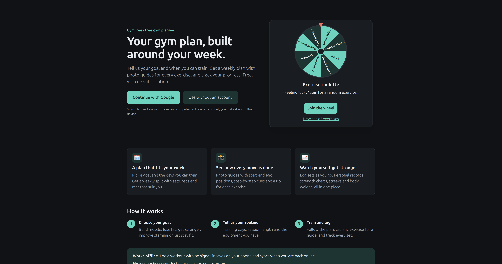
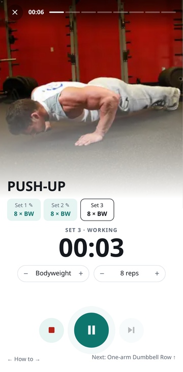
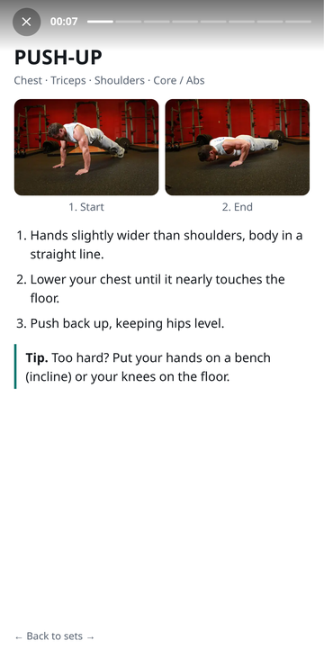
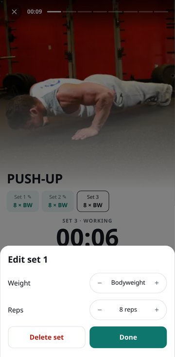

# GymFree

**A free gym planner. No subscription, no ads.**

[](https://gym.davish.dev/) [](https://github.com/Akchy/Gym-Exercises/actions/workflows/deploy.yml) [](LICENSE) 

Pick your goal and the days you can train, and GymFree builds you a weekly plan with photo guides for every exercise. It also tracks your sets, personal records and progress. It works offline and installs like an app on your phone.

**Try it: [gym.davish.dev](https://gym.davish.dev/)**

[](https://gym.davish.dev/)

### Workout mode

Start a workout on your phone and each exercise fills the screen. Tap start and stop to log a set, swipe up for the next exercise, and swipe sideways to see how to do it. Tap a logged set to fix it.

<p>
  
  
  
</p>

## Host your own

GymFree builds to a plain static site, so it runs on any web host.

[](https://vercel.com/new/clone?repository-url=https://github.com/Akchy/Gym-Exercises&env=VITE_SUPABASE_URL,VITE_SUPABASE_PUBLISHABLE_KEY&envDescription=Optional%3A%20leave%20empty%20to%20run%20without%20sign-in) [](https://app.netlify.com/start/deploy?repository=https://github.com/Akchy/Gym-Exercises)

### Option 1: Docker (your own server)

```bash
git clone https://github.com/Akchy/Gym-Exercises.git
cd Gym-Exercises
docker build -t gymfree .
docker run -d -p 8080:8080 --restart unless-stopped gymfree
```

Open `http://your-server:8080`. Put it behind your usual reverse proxy for HTTPS.

### Option 2: Any static host

Needs Node.js 22+.

```bash
npm install
npm run build
```

Upload the `dist/` folder to any static host (nginx, S3, Cloudflare Pages, and so on).

### Option 3: GitHub Pages

Fork the repo, then go to **Settings → Pages → Source: GitHub Actions**. Every push to `main` deploys automatically.

## Optional: Google sign-in

Without any setup, GymFree works fully and keeps data on each device. To let people sign in with Google and sync across devices, you need a free [Supabase](https://supabase.com) project:

1. **Database**: in Supabase, open the SQL editor and run [`deploy/supabase/schema.sql`](deploy/supabase/schema.sql).
2. **Google OAuth client**: Google Cloud console → APIs & Services → Credentials → Create OAuth client ID (Web application). Authorised redirect URI: `https://<your-project>.supabase.co/auth/v1/callback`.
3. **Turn on Google in Supabase**: Authentication → Sign In / Providers → Google → paste the client ID and secret.
4. **Allow your site's address**: Authentication → URL Configuration → set the Site URL and add it to the Redirect URLs.
5. **Give the build two public values**:

   | Variable | Where to find it |
   | --- | --- |
   | `VITE_SUPABASE_URL` | Project Settings → API → Project URL |
   | `VITE_SUPABASE_PUBLISHABLE_KEY` | Project Settings → API Keys → Publishable key (`sb_publishable_…`) |

   - Docker: `docker build --build-arg VITE_SUPABASE_URL=... --build-arg VITE_SUPABASE_PUBLISHABLE_KEY=... -t gymfree .`
   - GitHub Pages: repo Settings → Secrets and variables → Actions → **Variables**
   - Vercel / Netlify: the project's environment variables
   - Local build: copy `.env.example` to `.env.local`

Only use the **publishable** key. Never put the Google client secret or a Supabase secret key in these variables.

## More

- [Developer guide](docs/DEVELOPMENT.md): features, architecture, tests, sync and security details
- [MIT License](LICENSE). The exercise photos come from [free-exercise-db](https://github.com/yuhonas/free-exercise-db) and are in the public domain.

Plans and calorie estimates are general guidance, not medical advice.
